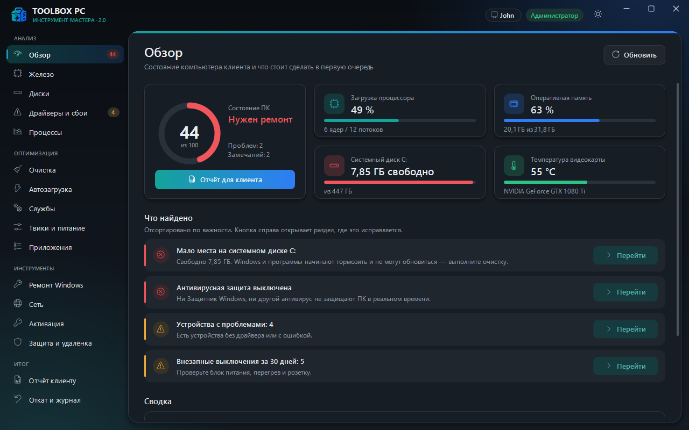
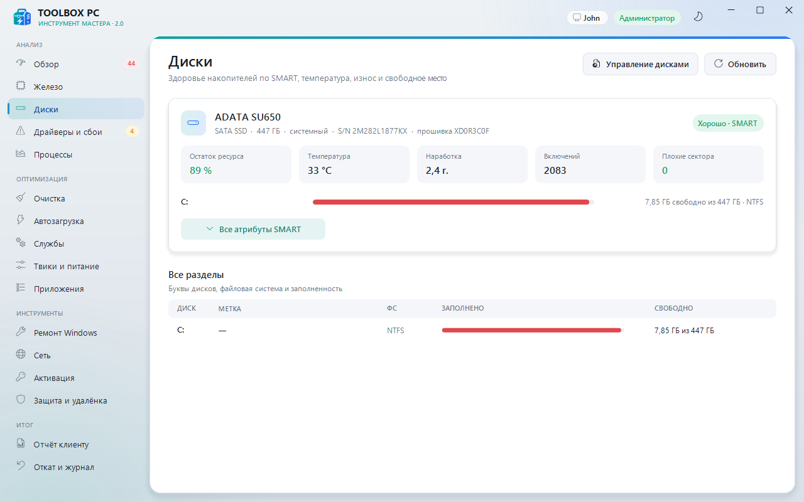
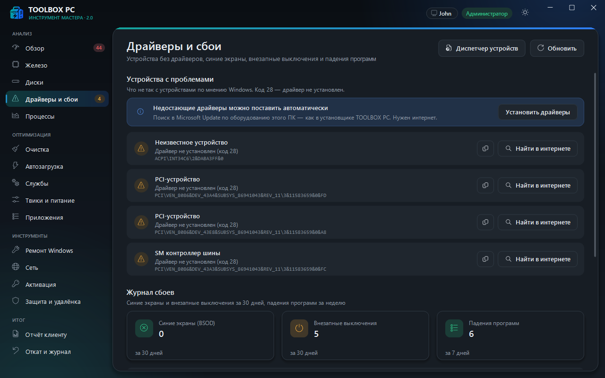
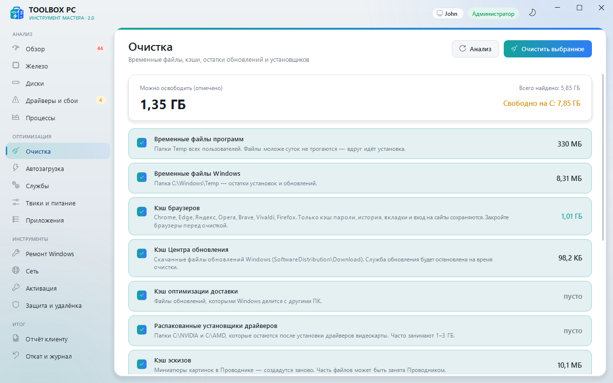
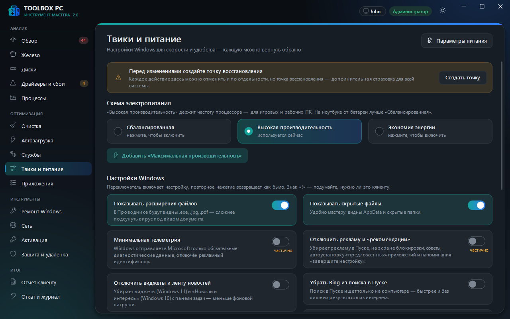
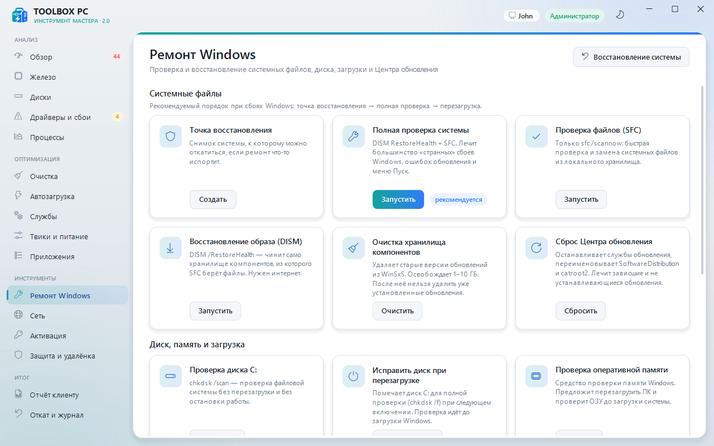

# TOOLBOX PC — инструмент мастера

Программа для мастера, который чинит и настраивает чужие компьютеры: анализ железа и Windows,
здоровье дисков (SMART), оптимизация с откатом, ремонт системы, сеть, активация, проверка на вирусы,
удалённая помощь и красивый отчёт для клиента.

Один файл `ToolboxPC.exe` (~1,6 МБ), написан на C++ (Win32 + GDI+), **без .NET, без библиотек и без
установки**. Работает на любой Windows 10/11 x64 — используются только встроенные компоненты Windows
(GDI+, WMI, PowerShell 5.1, штатные `sfc`, `dism`, `chkdsk`, `netsh`, `slmgr`).

Оформление — как у загрузочной флешки TOOLBOX PC: бирюзово-синий градиент, иконки,
**светлая и тёмная тема** (переключатель ☀/☾ в заголовке, по умолчанию — как в Windows).



## Сборка

```bat
build.bat
```

Нужен компилятор MinGW-w64 g++ (WinLibs) в `PATH`:
`winget install BrechtSanders.WinLibs.POSIX.UCRT`. Сборка занимает около минуты, на выходе —
`ToolboxPC.exe` рядом с `build.bat`. Всё статически слинковано: на чужом ПК ничего доустанавливать не нужно.

## Запуск

Двойной клик по `ToolboxPC.exe`. Программа **всегда просит права администратора** (одно окно UAC при
старте) — без них не читается SMART, не меняются службы, не работают DISM/SFC.

> Запускайте программу из учётной записи клиента (если она с правами администратора). Настройки
> «текущего пользователя» (автозагрузка HKCU, часть твиков) применяются к той учётной записи,
> от имени которой запущена программа. Если ввести в UAC пароль *другого* администратора,
> они применятся к нему.

### Флешка мастера

Программа портативная. На флешку копируются:

```
ToolboxPC.exe
tools\                       ← из папки programm\tools
   avz\avz4\avz.exe          AVZ (лечилка)
   rustdesk\rustdesk.exe     RustDesk (удалённый доступ)
   sysinternals\             (необязательно) Autoruns64.exe, procexp64.exe, tcpview64.exe
   integrity.txt             эталонные SHA-256 инструментов
```

Папка `tools` ищется рядом с exe, а если её там нет — на уровень выше (поэтому в этой папке
проекта всё работает с общей `programm\tools`). Новую программу можно положить и в папку
`Programs` установочной флешки WinInstaller.

Что программа пишет на диск:

| Что | Где |
|---|---|
| Настройки (тема, имя мастера, контакты) | `settings.ini` рядом с exe; если флешка защищена от записи — `%LOCALAPPDATA%\ToolboxPC` |
| Отчёты для клиентов | `reports\` рядом с exe; если нельзя писать — Рабочий стол |
| Журнал изменений и данные для отката | `C:\ProgramData\ToolboxPC` (`journal.txt`, `backup\`) — **остаются на ПК клиента**, откатить можно и при следующем визите |

## Разделы

### Анализ

| Раздел | Что показывает |
|---|---|
| **Обзор** | Оценка состояния ПК 0–100, живая загрузка ЦП и памяти, свободное место, температура видеокарты и список «Что найдено» — от критичного к мелочам, с кнопкой перехода туда, где это исправляется. |
| **Железо** | Процессор, плата и BIOS (UEFI/Legacy), модули памяти по слотам (тип, частота, свободные слоты, одноканальный режим), видеокарты (видеопамять, температура, возраст драйвера), Windows, батарея ноутбука (износ), **готовность к Windows 11** (UEFI, Secure Boot, TPM 2.0, ОЗУ, диск). |
| **Диски** | Для каждого накопителя — **SMART**: состояние Хорошо/Внимание/Плохо, остаток ресурса SSD, температура, наработка, включения, переназначенные/нестабильные сектора, ошибки CRC (кабель). Для NVMe — лог здоровья (износ, резерв, ошибки носителя, записано ТБ). Полная таблица атрибутов, разделы и заполненность. |
| **Драйверы и сбои** | Устройства с ошибками Диспетчера устройств с понятным описанием кода (28 — нет драйвера и т. д.), кнопки «Найти в интернете» по ID и **«Установить драйверы»** из Microsoft Update (как в установщике). Журнал сбоев: синие экраны за 30 дней с расшифровкой кода (видеодрайвер, ОЗУ, диск…), внезапные выключения, самые падающие программы, дампы памяти. |
| **Процессы** | «Что тормозит»: программы, сгруппированные по имени, с реальными иконками, нагрузкой на ЦП и памятью, обновление каждые 2 с, сортировка, завершение (системные процессы защищены). |




### Оптимизация

| Раздел | Что делает | Откат |
|---|---|---|
| **Очистка** | Анализ и удаление: Temp всех пользователей (файлы старше суток), Windows\Temp, кэш браузеров (Chrome, Edge, Яндекс, Opera, Brave, Vivaldi, Firefox — только кэш, пароли и история не трогаются), кэш Центра обновления, оптимизации доставки, распакованные установщики NVIDIA/AMD, кэш эскизов. Отдельно (выключено по умолчанию, с предупреждением): дампы памяти, кэш шейдеров, корзина, **Windows.old**. | Удаление файлов необратимо — поэтому только кэши и временные файлы, и перед очисткой окно со списком. |
| **Автозагрузка** | Записи реестра Run (пользователь, все, 32-бит) и папки «Автозагрузка» с иконками, издателем и путём. Переключатель — тот же механизм, что в Диспетчере задач. Записи с ненайденным файлом помечаются, их можно удалить. | Переключатель обратим; удалённые записи возвращаются из журнала (ярлыки сохраняются в бэкап). |
| **Службы** | Список проверенных служб с пояснениями: телеметрия, карты, демо-режим, факс, Xbox, печать, SysMain, индексатор и др. Кнопка «Отключить безопасные» трогает только службы без риска; рискованные — по одной, с предупреждением. | Кнопка «Вернуть» у каждой службы (прежний тип запуска из журнала, а если журнала нет — значение Windows по умолчанию). |
| **Твики и питание** | Схемы электропитания (выбор, добавление «Максимальная производительность») и до 18 настроек: расширения и скрытые файлы, реклама и «рекомендации», телеметрия, Bing в Пуске, виджеты, Copilot, классическое контекстное меню Win11, задержка автозагрузки, Game DVR, залипание клавиш, ускорение мыши, быстрый запуск, гибернация, «не засыпать от сети», фоновые приложения, пауза обновлений на 5 недель, запрет драйверов через Windows Update. Рискованные помечены «!». | Повторное нажатие переключателя возвращает прежние значения (сохранённые перед изменением). |
| **Приложения** | Встроенные приложения Windows: мусор (Clipchamp, новости, Solitaire, Bing, игры King, TikTok…) отмечается автоматически, системные (Магазин, Фото, Калькулятор, кодеки) не показываются вовсе. Удаление для всех пользователей. Вкладка «Установленные программы»: поиск, размер, дата, подсветка подозрительных (пробные антивирусы, «оптимизаторы», Mail.ru/Амиго, «обновляторы» драйверов) с объяснением, запуск штатного деинсталлятора; кнопка «Установить из файла» запускает выбранный установщик (например, Uninstall Tool с флешки). | Встроенное приложение возвращается из журнала кнопкой «В Store». Программы — только переустановкой. |

На страницах «Службы» и «Твики» вверху — напоминание и кнопка **«Создать точку восстановления»**.




### Инструменты

| Раздел | Что делает |
|---|---|
| **Ремонт Windows** | Точка восстановления; **полная проверка** (DISM RestoreHealth + SFC); отдельно SFC и DISM; очистка хранилища компонентов WinSxS; сброс Центра обновления (папки переименовываются, а не удаляются); проверка диска `chkdsk /scan`; проверка диска при перезагрузке; проверка памяти; перезагрузка в BIOS/UEFI и в среду восстановления; безопасный режим (вкл/выкл); быстрый запуск 16 системных оснасток. Вывод команд — в консоли внизу страницы, с возможностью остановить и скопировать. |
| **Сеть** | Проверка: интернет (тест Microsoft NCSI, распознаёт «нужен вход через портал»), пинг роутера и 8.8.8.8, DNS — с подсказкой, что делать. Адаптеры с IP, шлюзом, DNS, MAC, скоростью. DNS одним кликом: авто, Cloudflare, Google, Яндекс, AdGuard. Сброс кэша DNS, обновление IP, отключение прокси (признак рекламного вируса), полный сброс сети (Winsock + TCP/IP), сброс брандмауэра, восстановление `hosts`. DNS, прокси и hosts откатываются из журнала. |
| **Активация** | Статус лицензии, тип (OEM/Retail/KMS), последние символы ключа; **ключ, зашитый в BIOS** ноутбука — подставляется одной кнопкой. Установка легального ключа и активация штатным `slmgr` с выводом в консоль, подробный статус, советы по частым ошибкам. Обхода лицензии нет и не будет. |
| **Защита и удалёнка** | Состояние Защитника и сторонних антивирусов, обновление баз, быстрая/полная проверка. **AVZ** и **RustDesk** из папки `tools` с проверкой SHA-256 перед запуском (если файл подменён — предупреждение). «Быстрая помощь» Windows. Autoruns / Process Explorer / TCPView (если положены в `tools\sysinternals`, иначе — ссылка на сайт Microsoft). Таблица целостности всех инструментов из `integrity.txt`. |



### Итог

| Раздел | Что делает |
|---|---|
| **Отчёт клиенту** | HTML-отчёт в фирменном стиле: оценка, найденные проблемы, диски и разделы, оборудование, **что сделано мастером** за сессию, комментарий и контакты мастера (запоминаются). Открывается в любом браузере, печатается или сохраняется в PDF (Ctrl+P). |
| **Откат и журнал** | Все изменения программы на этом ПК (эта сессия / вся история) с кнопкой «Откатить» у обратимых, кнопки «Восстановление системы» и «Папка бэкапов». |

## Проверка целостности инструментов

Эталоны лежат в `tools\integrity.txt`, строка: `<sha256>  tools/путь/к/файлу.exe`. Добавить новый:

```bash
sha256sum tools/путь/к/файлу.exe
```

## Командная строка

| Ключ | Что делает |
|---|---|
| `ToolboxPC.exe --report C:\путь\отчёт.html` | Собрать сведения и сохранить отчёт без окна (подставляются мастер и контакты из `settings.ini`). |
| `ToolboxPC.exe --shot <папка> [--theme light\|dark] [--page N] [--size 1280x800] [--scale 1.5]` | Для разработки: нарисовать страницы в PNG без показа окна. |

## Честно об ограничениях

- **Температура процессора** в Windows без драйвера ядра недоступна; показываются температура видеокарты
  (через драйвер WDDM, работает на NVIDIA/AMD/Intel), дисков (SMART) и термозона ACPI, если плата её отдаёт.
- SMART у дисков в **USB-боксах** часто недоступен — это ограничение переходников.
- На ноутбуках с Modern Standby Windows не разрешает добавлять схемы питания.
- DISM RestoreHealth требует интернет (берёт файлы с серверов Microsoft).
- Удаление файлов при очистке и деинсталляция программ необратимы — для них отката нет.

## Как устроено

```
ToolboxPC\
  build.bat            сборка одной командой
  src\
    main.cpp           окно без рамки, отрисовка, ввод, фоновые задачи, режимы --report/--shot
    ui.cpp, ui.h       движок интерфейса на GDI+: темы, градиенты, кнопки, переключатели, прокрутка, окна подтверждения
    sysinfo.cpp        WMI, SMART (ATA и NVMe), DXGI/D3DKMT (видеокарта), журнал событий, диагноз
    optimize.cpp       очистка, автозагрузка, службы, твики, питание, приложения
    pages_*.cpp        страницы разделов
    report.cpp         HTML-отчёт
    util.cpp           реестр, запуск команд без окон (OEM/UTF-8/UTF-16), журнал и откат, службы
    wmi.cpp            обёртка WMI
  res\                 иконка, логотип, манифест (права администратора, Per-Monitor DPI), версия
  test\                модульные тесты (unit.cpp) и проверка окна на скрытом рабочем столе (hiddesk.cpp)
```

Старая консольная версия (`programm\main.cpp`, `toolbox.exe`) оставлена как есть; все её функции
(активация, AVZ, RustDesk, проверка SHA-256, ссылки на Sysinternals) перенесены в новую программу.
